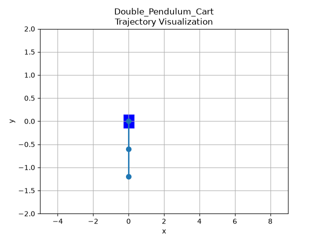
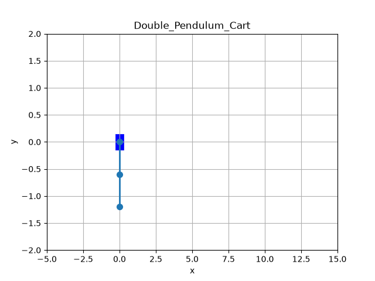

# Trajectory-Optimization-TVLQR-Cart-Double-Pendulum
This repository contains the **swing-up control of a cart double-pendulum** using **trajectory optimization** (direct collocation with the trapezoidal rule, solved with **IPOPT**) and a **Time-Varying Linear Quadratic Regulator (TVLQR)** that tracks the optimized trajectory, implemented in Python with NumPy/JAX. The [project](https://github.com/ChouliarasVasileios/Trajectory-Optimization-TVLQR-Cart-Double-Pendulum/blob/main/ECEUoP_RS_2_HW_3.pdf) was developed as part of the **Robotic Systems II** course at the **Department of Electrical and Computer Engineering, University of Patras**, supervised by **Assistant Professor Konstantinos Chatzilygeroudis**.

## Overview

| Trajectory Optimization | Controlling via TVLQR |
|:---:|:---:|
|  |  |
| Optimized swing-up from the hanging to the upright position in 5 s — trapezoidal collocation, 101 knot points, dt = 0.05 s, \|u\| ≤ 20 N (red: end-effector trace) | TVLQR tracking the optimized swing-up with the non-linear dynamics and balancing the pendulum upright — 501 knot points, dt = 0.01 s, \|u\| ≤ 20 N |

## Project Overview
The aim of this assignment was to:

- **Model** the dynamics of a cart double-pendulum (cart mass m₁ and two links with masses m₂, m₃ and lengths l₂, l₃, with friction b on the cart) and discretize them with **4th-order Runge–Kutta**.
- Formulate the **swing-up** from the hanging (x₀ = [0, π, π, 0, 0, 0]ᵀ) to the upright (x_f = 0) position as a **non-linear trajectory optimization** problem using **direct collocation with the trapezoidal rule**, and solve it with **IPOPT** ([cyipopt](https://github.com/mechmotum/cyipopt)) under the control limits −20 ≤ u ≤ 20 N.
- **Linearize** the system around every point of the optimized trajectory using automatic differentiation (JAX) and compute the time-varying gains with the **Riccati backward recursion** (**TVLQR**).
- Control the real non-linear system with the TVLQR so that it follows the optimized trajectory and balances the double pendulum at the unstable upright equilibrium.

## Installation

`cyipopt` needs the IPOPT library. On Debian/Ubuntu:

```bash
sudo apt install coinor-libipopt-dev pkg-config python3-dev
```

Then:

```bash
git clone https://github.com/ChouliarasVasileios/Trajectory-Optimization-TVLQR-Cart-Double-Pendulum.git
cd Trajectory-Optimization-TVLQR-Cart-Double-Pendulum
python3 -m venv .venv
source .venv/bin/activate
pip install -r requirements.txt
```

## Usage

```bash
python src/Modeling.py                     # Part 1: modeling + simulation
python src/Trajectory_Optimization.py      # Part 2: swing-up trajectory optimization
python src/Controlling_via_TVLQR.py        # Part 3: TVLQR tracking of the optimized trajectory
```

## Report
A detailed technical report ([Homework3_Robotics_Systems_II_Report.pdf](https://github.com/ChouliarasVasileios/Trajectory-Optimization-TVLQR-Cart-Double-Pendulum/blob/main/Homework3_Robotics_Systems_II_Report.pdf)) is provided in Greek, documenting:

- The mathematical modeling of the cart double-pendulum
- Trajectory optimization with the trapezoidal rule
- Control via Time-Varying LQR
- Simulation results

## Acknowledgements
This project was completed as part of the Robotic Systems II course at the University of Patras under the guidance of **Assistant Professor Konstantinos Chatzilygeroudis**.
